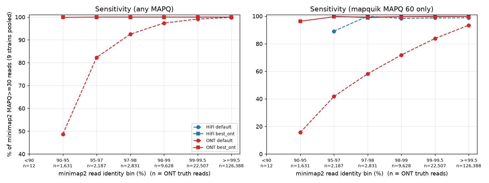
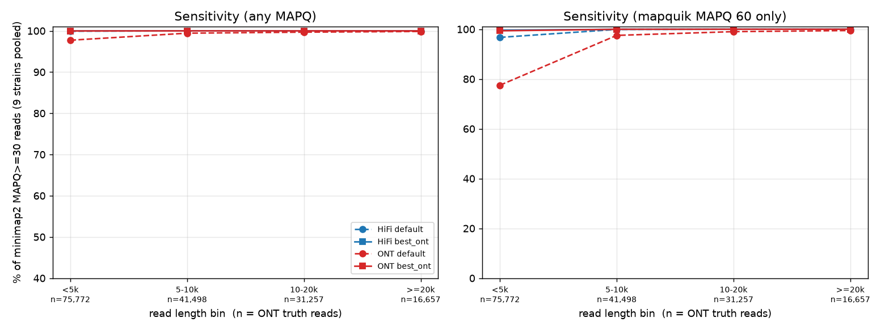

# mapquik on ONT R10.4 reads vs PacBio HiFi

Evaluation of the read mapper [mapquik](../../README.md) v0.2.0 (designed for >97 % identity HiFi reads) on
ONT R10.4 reads, compared with HiFi reads of the same 9 bacterial strains, using minimap2 as the reference mapper.
The ONT reads were basecalled with dorado's **`sup`** model and **`--min-qscore 10`**; all results below apply to
reads processed that way (see [Caveats](#caveats)).
Everything here was run with an unmodified mapquik; scripts and tidy results are in this directory.

## TL;DR
- **The R10.4 reads are far better than the "<97 %" regime mapquik warns about.** Median identity to the same-strain
  HiFi assembly is **99.74 %** (BLAST-style 99.68 %), 97.7 % of reads are ≥97 % and 90 % are ≥99 %; HiFi is 100.0 % median.
  Only ~1 % of ONT reads are <95 %. This is `sup` basecalling with reads below mean Q10 already removed.
- **Default mapquik on ONT already maps almost everything correctly, but with low confidence.** Pooled over 9 strains
  (165,184 ONT / 171,513 HiFi reads with minimap2 MAPQ ≥30): sensitivity **98.74 % ONT vs 99.97 % HiFi**; sensitivity counting only
  mapquik MAPQ-60 hits **88.8 % ONT vs 98.9 % HiFi**; wrong-rate 0.002 % vs 0.001 %. The loss is concentrated in reads
  <97 % identity (90–95 %: 49 % mapped, 16 % at MAPQ 60) and in reads <5 kb.
- **Recommended ONT setting: `-k 2 -l 21 -d 0.03`** (rest default; picked on FAM14197+FAM22000 only). On all 9 strains:
  sensitivity **99.986 %**, MAPQ-60 sensitivity **99.69 %**, wrong-rate 0.002 %, i.e. HiFi-level. On the **7 held-out strains**
  alone: 99.985 % / 99.69 % / 0.002 % (default: 98.73 % / 88.61 % / 0.002 %), so it generalizes. It does not hurt HiFi
  (99.992 % / 99.85 %, from 99.970 % / 99.04 %).
- **Speed:** mapquik stays ~4–6× faster than `minimap2 -x map-ont/map-hifi` at 16 threads (20k reads, ~2.5 Mb reference,
  wall time incl. indexing): ONT 0.91 s (default) / 1.04 s (`-k 2 -l 21 -d 0.03`) vs 4.48 s; HiFi 0.47 / 0.60 s vs 2.68 s.
  The recommended setting costs ~15 % more time and raises mapquik's peak RSS from ~300 to ~540 MB.
- Wrong mappings are essentially absent in all settings (≤0.01 % in every strain), but see the caveats: these are small bacterial genomes.

## Results

Truth set = reads whose minimap2 primary alignment has MAPQ ≥30 (see Methods). *sens* = fraction of truth reads that
mapquik places at the same locus; *sens60* = same, counting only mapquik MAPQ-60 lines; *wrong-rate* = wrong / (correct + wrong).
`best_ont` = `-k 2 -l 21 -d 0.03`. Per-strain, per-contig and sweep detail is in [`results/tables.md`](results/tables.md); raw
tidy data in `results/*.tsv`.

### Pooled summary
Counts are summed over strains. `mapquik s`, `minimap2 s` and RSS are per-strain means; `speedup` = sum(minimap2 s) / sum(mapquik s).

| strains | tech | setting | n_truth | sens | sens60 | wrong-rate | wrong60 | unmapped | mapquik s | minimap2 s | speedup | mapquik RSS MB | minimap2 RSS MB |
|---|---|---|---|---|---|---|---|---|---|---|---|---|---|
| all 9 | HiFi | default | 171513 | 99.969% | 98.862% | 0.001% | 0.000% | 52 | 0.47 | 2.68 | 5.7x | 260 | 257 |
| all 9 | HiFi | best_ont | 171513 | 99.992% | 99.853% | 0.001% | 0.001% | 11 | 0.60 | 2.68 | 4.5x | 494 | 257 |
| all 9 | ONT | default | 165184 | 98.741% | 88.825% | 0.002% | 0.000% | 2077 | 0.91 | 4.48 | 4.9x | 302 | 519 |
| all 9 | ONT | best_ont | 165184 | 99.986% | 99.694% | 0.002% | 0.001% | 19 | 1.04 | 4.48 | 4.3x | 537 | 519 |
| tuning (2) | HiFi | default | 39880 | 99.965% | 98.262% | 0.003% | 0.000% | 13 | 0.46 | 2.60 | 5.7x | 262 | 226 |
| tuning (2) | HiFi | best_ont | 39880 | 99.995% | 99.832% | 0.000% | 0.000% | 2 | 0.60 | 2.60 | 4.3x | 495 | 226 |
| tuning (2) | ONT | default | 39856 | 98.766% | 89.502% | 0.003% | 0.000% | 491 | 1.05 | 5.29 | 5.0x | 311 | 456 |
| tuning (2) | ONT | best_ont | 39856 | 99.990% | 99.709% | 0.005% | 0.003% | 2 | 1.19 | 5.29 | 4.4x | 546 | 456 |
| held-out (7) | HiFi | default | 131633 | 99.970% | 99.044% | 0.000% | 0.000% | 39 | 0.47 | 2.70 | 5.7x | 259 | 266 |
| held-out (7) | HiFi | best_ont | 131633 | 99.992% | 99.859% | 0.002% | 0.002% | 9 | 0.60 | 2.70 | 4.5x | 494 | 266 |
| held-out (7) | ONT | default | 125328 | 98.733% | 88.609% | 0.002% | 0.000% | 1586 | 0.87 | 4.25 | 4.9x | 299 | 537 |
| held-out (7) | ONT | best_ont | 125328 | 99.985% | 99.689% | 0.002% | 0.001% | 17 | 1.00 | 4.25 | 4.3x | 535 | 537 |

"tuning (2)" = FAM14197 + FAM22000, on which `best_ont` was chosen; "held-out (7)" = the other seven strains. The
held-out numbers match the tuning numbers, so the setting is not overfitted to two strains. Per strain, ONT default sens ranges
98.1–99.0 % (sens60 81.0–92.5 %, the weakest strain being FAM20862, the one with the shortest ONT reads, median 2.8 kb);
ONT `best_ont` ranges 99.96–99.995 % (sens60 99.4–99.9 %). Per-strain table: [`results/tables.md`](results/tables.md#per-strain).

### Where default mapquik loses ONT reads: read identity
Pooled over all 9 strains, binned by the minimap2 identity (1−`de`) of each read. Cells: sensitivity / MAPQ-60 sensitivity.

Cells: sensitivity / MAPQ-60 sensitivity. Wrong-rate is below 0.1% in every cell with n>=100 (see `results/bins.tsv`).

| bin | n ONT | n HiFi | HiFi default | HiFi best_ont | ONT default | ONT best_ont |
|---|---|---|---|---|---|---|
| <90 | 12 | 1 | 0.0% / 0.0% | 0.0% / 0.0% | 41.7% / 41.7% | 100.0% / 91.7% |
| 90-95 | 1631 | 8 | 100.0% / 87.5% | 100.0% / 100.0% | 48.7% / 15.6% | 99.9% / 96.3% |
| 95-97 | 2187 | 46 | 100.0% / 89.1% | 100.0% / 100.0% | 82.3% / 41.8% | 100.0% / 99.6% |
| 97-98 | 2831 | 88 | 100.0% / 100.0% | 100.0% / 98.9% | 92.5% / 58.2% | 100.0% / 99.4% |
| 98-99 | 9628 | 684 | 100.0% / 98.4% | 100.0% / 99.7% | 97.4% / 71.9% | 100.0% / 99.6% |
| 99-99.5 | 22507 | 4157 | 99.9% / 98.7% | 100.0% / 99.9% | 99.1% / 83.9% | 100.0% / 99.6% |
| >=99.5 | 126388 | 166529 | 100.0% / 98.9% | 100.0% / 99.9% | 99.8% / 93.4% | 100.0% / 99.8% |



Default mapquik loses reads in a graded way as identity drops: 92 % mapped at 97–98 %, 82 % at 95–97 %, 49 % at 90–95 %, and
the MAPQ-60 fraction falls faster still. Reads <97 % are only 2.3 % of the ONT truth reads, which is why overall sensitivity is
still 98.7 %. HiFi has very few reads below 99 % (n=1–684 per bin), so its curve is only drawn where n≥30. With `best_ont`
every bin from 90 % up is ≥99.9 % mapped and ≥96 % at MAPQ 60 (the 90–95 % bin: 99.9 % / 96.3 %).

Same table for the 7 held-out strains only:

Cells: sensitivity / MAPQ-60 sensitivity. Wrong-rate is below 0.1% in every cell with n>=100 (see `results/bins.tsv`).

| bin | n ONT | n HiFi | HiFi default | HiFi best_ont | ONT default | ONT best_ont |
|---|---|---|---|---|---|---|
| <90 | 11 | 1 | 0.0% / 0.0% | 0.0% / 0.0% | 45.5% / 45.5% | 100.0% / 90.9% |
| 90-95 | 1182 | 6 | 100.0% / 100.0% | 100.0% / 100.0% | 50.5% / 17.6% | 99.8% / 96.4% |
| 95-97 | 1673 | 34 | 100.0% / 88.2% | 100.0% / 100.0% | 82.0% / 42.0% | 100.0% / 99.6% |
| 97-98 | 2170 | 72 | 100.0% / 100.0% | 100.0% / 98.6% | 91.8% / 57.8% | 100.0% / 99.3% |
| 98-99 | 7337 | 555 | 100.0% / 98.7% | 100.0% / 99.6% | 97.2% / 71.6% | 100.0% / 99.6% |
| 99-99.5 | 16769 | 3277 | 99.9% / 98.9% | 100.0% / 100.0% | 99.1% / 83.5% | 100.0% / 99.6% |
| >=99.5 | 96186 | 127688 | 100.0% / 99.1% | 100.0% / 99.9% | 99.8% / 93.2% | 100.0% / 99.8% |

### Read length
Cells: sensitivity / MAPQ-60 sensitivity. Wrong-rate is below 0.1% in every cell with n>=100 (see `results/bins.tsv`).

| bin | n ONT | n HiFi | HiFi default | HiFi best_ont | ONT default | ONT best_ont |
|---|---|---|---|---|---|---|
| <5k | 75772 | 57473 | 99.9% / 96.7% | 100.0% / 99.6% | 97.7% / 77.5% | 100.0% / 99.4% |
| 5-10k | 41498 | 78194 | 100.0% / 99.9% | 100.0% / 100.0% | 99.4% / 97.5% | 100.0% / 100.0% |
| 10-20k | 31257 | 35180 | 100.0% / 100.0% | 100.0% / 100.0% | 99.7% / 99.0% | 100.0% / 100.0% |
| >=20k | 16657 | 666 | 100.0% / 100.0% | 100.0% / 100.0% | 99.9% / 99.5% | 100.0% / 100.0% |



At default, the ONT shortfall is mostly short reads (<5 kb: 97.7 % / 77.5 %), because short reads have fewer minimizers and
more often fall below the confidence threshold. `best_ont` removes the dependence on length (99.4 % at MAPQ 60 even for <5 kb).

### Contig coverage
mapquik's JSON coverage report agrees with minimap2's primary-alignment coverage: breadth is 1.000 on all 29 contigs
(both mappers, both techs, both settings; 20k reads is deep for these genomes). Depth is ~3 % lower than minimap2's for ONT
(median ratio 0.97; presumably because mapquik reports only the chained part of each read) and ≈1.00 for HiFi. A few small, plasmid-like contigs with
few reads deviate more (min ratio 0.79 for HiFi `best_ont`, 0.83 for ONT `best_ont`); see `results/tables.md`.

### Parameter sweep (ONT)
Sweep on FAM14197 + FAM22000 (ONT, ~40k truth reads pooled), `sweep.py`: one factor at a time around the defaults, a full grid
k∈{2..6} × l∈{13,15,17,19,21,25,31} × d∈{.005,.01,.02,.03,.05} × HPC on/off, an extension to d∈{.07,.1,.2} and k∈{1,2,3,5},
then chain/seed/gap-diff around the optimum (490 settings in total, `results/sweep.tsv`). Times are the sum of the two strains.

Defaults and the chosen setting:

| k | l | density | hpc | chain | seed | gap_diff | sens | wrong_rate | sens60 | wrong_rate60 | mq_wall_s |
|---|---|---|---|---|---|---|---|---|---|---|---|
| 5 | 31 | 0.01 | True | 4 | 11 | 2000 | 0.98766 | 0.00003 | 0.89502 | 0.00000 | 2.11 |
| 2 | 21 | 0.03 | True | 4 | 11 | 2000 | 0.99990 | 0.00005 | 0.99709 | 0.00003 | 2.32 |

Top 10 under the selection rule below (the full ranking is in `results/sweep.tsv`):

| k | l | density | hpc | chain | seed | gap_diff | sens | wrong_rate | sens60 | wrong_rate60 | mq_wall_s |
|---|---|---|---|---|---|---|---|---|---|---|---|
| 2 | 21 | 0.03 | True | 4 | 11 | 2000 | 0.99990 | 0.00005 | 0.99709 | 0.00003 | 2.32 |
| 2 | 15 | 0.02 | False | 4 | 11 | 2000 | 0.99992 | 0.00000 | 0.99734 | 0.00000 | 2.33 |
| 2 | 21 | 0.03 | True | 3 | 11 | 2000 | 0.99990 | 0.00005 | 0.99752 | 0.00003 | 2.33 |
| 3 | 13 | 0.02 | False | 4 | 11 | 2000 | 0.99987 | 0.00003 | 0.99709 | 0.00000 | 2.33 |
| 2 | 21 | 0.03 | True | 4 | 11 | 500 | 0.99990 | 0.00005 | 0.99709 | 0.00003 | 2.34 |
| 2 | 21 | 0.03 | True | 4 | 11 | 1000 | 0.99990 | 0.00005 | 0.99709 | 0.00003 | 2.34 |
| 2 | 19 | 0.03 | True | 4 | 11 | 2000 | 0.99995 | 0.00003 | 0.99747 | 0.00000 | 2.35 |
| 3 | 15 | 0.02 | False | 4 | 11 | 2000 | 0.99990 | 0.00000 | 0.99681 | 0.00000 | 2.35 |
| 2 | 21 | 0.03 | True | 8 | 11 | 2000 | 0.99990 | 0.00005 | 0.99634 | 0.00003 | 2.35 |
| 2 | 25 | 0.02 | False | 4 | 11 | 2000 | 0.99990 | 0.00003 | 0.99684 | 0.00000 | 2.35 |

One factor at a time (all others default):

| change | sens | sens60 | wrong-rate | time (s) |
|---|---|---|---|---|
| default (k=5 l=31 d=0.01) | 98.77% | 89.50% | 0.003% | 2.11 |
| k=2 / 3 / 4 | 99.88 / 99.68 / 99.29% | 95.8 / 93.9 / 91.7% | 0.010 / 0.003 / 0.005% | 2.23 / 2.25 / 2.14 |
| l=13 / 21 / 25 | 99.47 / 99.10 / 98.78% | 91.6 / 89.9 / 86.8% | ≤0.005% | ≈2.1 |
| d=0.005 | 95.17% | 70.1% | 0.011% | 2.04 |
| d=0.02 / 0.05 / 0.1 | 99.66 / 99.965 / 99.997% | 97.8 / 99.7 / 99.9% | ≤0.003% | 2.25 / 2.63 / 3.21 |
| `--nohpc` | 99.18% | 93.9% | 0.003% | 2.16 |
| seed=3 (default 11) | 98.77% | 97.6% | 0.003% | 2.14 |
| chain=2 | 98.77% | 93.2% | 0.003% | 2.15 |
| chain=3…8, gap-diff=500…5000 | unchanged | 89.2–90.2% | ≤0.003% | ≈2.1 |

- **Density is the strongest lever**, then k (smaller k tolerates more errors between consecutive minimizers), then `--nohpc` and
  smaller l. They stack. `--density 0.05` alone gets sens 99.965 % / sens60 99.66 % for +25 % time.
- `seed`/`chain` only change which hits are labelled MAPQ 60, never which reads are mapped (see Caveats). The wrong-rate limit
  (≤ max(0.5 %, HiFi default)) only excludes k=1 (useless: 35–50 % sens, wrong-rate up to 53 %).
- **Selection rule.** The stated goal was max sensitivity subject to wrong-rate ≤ max(0.5 %, HiFi-default wrong-rate). Sensitivity saturates
  (>99.99 %) on a wide plateau of settings, and the raw maximum (d=0.2, no HPC, ~2.2× the default time) is at a grid edge. So among
  settings within 0.02 pp of the best sensitivity and 0.5 pp of the best sens60, the fastest was taken (`sweep.select`);
  differences within the plateau are timing noise, and settings such as `-k 2 -l 15 -d 0.02 --nohpc` are equivalent.
  Chosen: **`-k 2 -l 21 -d 0.03`**, HPC on, chain/seed/gap-diff at default.

## Methods
- **Data** (read-only): `/home/thomas/Projects/mindtherest/data/{pb,ont}/<STRAIN>/reads.fastq.gz` (PacBio HiFi CCS; ONT R10.4) for 9
  strains with both technologies: FAM14197 FAM20838 FAM20851 FAM20853 FAM20856 FAM20862 FAM20866 FAM22000 FAM29080. **Reference for both
  techs is the PacBio assembly** `data/pb/<STRAIN>/assembly.fasta` (2.5–2.6 Mb chromosome plus plasmids/small contigs; 29 contigs total).
- **ONT basecalling** (`~/Projects/dataset-microsynth/3_basecalling.sh`): `dorado basecaller sup,6mA,4mC_5mC --emit-moves --min-qscore 10`
  (container `docker.io/nanoporetech/dorado:latest`, so the exact dorado/model version was not pinned). Reads with mean Q-score < 10
  were discarded by dorado before this evaluation.
- **Reads:** reservoir-sampled to ≤20,000 reads per (strain, tech) with a fixed seed (take all if fewer). FAM20838 ONT has only 12,659
  reads in total and FAM20851 only 13,089 (ONT) / 11,860 (HiFi). 171,860 HiFi and 165,748 ONT reads in total.
- **Truth:** `minimap2 -x map-hifi|map-ont -c --secondary=no -t 16`. A read is in the *truth set* if its primary alignment has MAPQ ≥30
  (99.8 % of HiFi and 99.7 % of ONT reads). Read identity = 1 − `de` of that alignment (`de` is gap-compressed; it is slightly optimistic vs.
  BLAST-style identity matches/alignment-length, which is ~0.06 pp lower for ONT; both medians are in `results/identity.tsv`; bins use 1−`de`).
- **mapquik:** `mapquik reads.fastq.gz --reference ref.fasta -p prefix --threads 16 --json prefix.json [params]`, default parameters
  (k=5, l=31, d=0.01, chain 4, seed 11, gap-diff 2000, HPC on) or `best_ont`.
- **Scoring:** mapquik is *correct* if it reports the same contig, same strand and reference overlap ≥50 % of the shorter of the two intervals;
  *wrong* if mapped elsewhere; *unmapped* otherwise. Multi-piece rule: the small contigs are circular, and many reads wrap around a contig end, so minimap2
  emits several primary (`tp:P`) pieces for one read while mapquik reports a single piece. A mapquik hit counts as correct if it matches
  **any** minimap2 primary piece of the read; the longest piece defines the read's MAPQ and identity. (Scoring against only the longest
  piece inflated the FAM22000 ONT wrong-rate to a spurious 5.5 %.) Also recorded: mapquik hits on reads minimap2 left unmapped or low-MAPQ
  (not scored; a handful per strain).
- **Timing:** `/usr/bin/time -v` wall time and max RSS, 16 threads, one run per setting, minimap2 and mapquik both reading the same gz FASTQ.
  mapquik time includes indexing the reference and process startup; with ~0.5–1.5 s per run, timings are good to ~±0.1 s only.
- Statistics are pooled by summing counts across strains (strains with more truth reads weigh more).

## Caveats
- **Basecalling matters most.** The ONT reads were basecalled with `sup` and filtered with `--min-qscore 10`. Both shift the identity
  distribution upward, and the filter removes the lowest-quality reads, which is where default mapquik fails (sensitivity falls off
  below ~97 % identity, see the identity-bin table). With `hac`/`fast` models, older chemistry or no Q-score filter, expect more reads
  in the low-identity bins and lower default sensitivity. Whether `-k 2 -l 21 -d 0.03` closes the gap there was not tested.
- **Small bacterial genomes** (2.5 Mb, few repeats). Wrong-rates (≈0.002 %, 3–5 reads per 165k) will not necessarily transfer to large or
  repetitive genomes, where the less specific `best_ont` seeds (k=2, 3× the density) might produce more wrong mappings, higher runtime and memory.
  Speed ratios are for 20k reads against ~2.5 Mb and are dominated by fixed costs (indexing, startup).
- **Truth is minimap2.** Reads that minimap2 maps badly are not scored; sensitivity says "mapquik finds what minimap2 finds", not absolute
  correctness. Identity is measured against an assembly of the same strain, not the true genome: assembly errors count as read errors, and
  the ONT reads may have contributed to the assembly or its polishing, so ONT identity may be optimistic or pessimistic in unknown ways.
- **mapquik's MAPQ is binary:** 60 if chain length ≥ `chain` or score ≥ `seed`, else 0; low-confidence hits are still written with MAPQ 0.
  So `chain`/`seed` change only sens60, not sens, and MAPQ says nothing about repeat ambiguity. sens60 is therefore a "confidence threshold"
  metric, not an ambiguity metric. The default ONT shortfall is mostly in this MAPQ-60 metric.
- Identity (1−`de`) is a gap-compressed divergence and slightly overestimates identity compared with BLAST identity; the identity-bin
  boundaries should be read with ~0.06 pp (median) of slack for ONT. 12 ONT reads fall <90 %, too few to interpret.
- The setting was chosen on 2 of the 9 strains (held-out results are given above); the plateau rule among near-equal settings is arbitrary.
- mapquik 0.2.0 specifics: format detection by file extension (the reference must end in `.fasta`/`.fa`, so the scripts symlink it as
  `ref.fasta`; paths must not contain `.fa.`), half-open ends in PAF, ≤1 line per read (verified), non-standard PAF columns 10/11.
- Timings are single runs on a shared 16-core machine.

## How to reproduce
```
cd experiments/r10
pixi install
pixi run all                 # subsample, minimap2 truth, mapquik default + best_ont on pb and ont, all 9 strains
                             # then aggregate -> results/*.tsv, report -> results/tables.md, plots -> results/*.png
pixi run report              # re-do aggregation + tables + figures from cached runs (no mappings)
pixi run sweep               # ONT parameter sweep on FAM14197+FAM22000 (roughly 15–30 min) -> results/sweep.tsv
```
- Inputs: `/home/thomas/Projects/mindtherest/data/{pb,ont}/<STRAIN>/{reads.fastq.gz,assembly.fasta}` (only the PacBio assembly is used).
  The mapquik binary is `../../target/release/mapquik` (`cargo build --release` at the repo root if missing).
- Large files and per-run caches are in `scratch/r10/` (git-excluded); a run is skipped if its result JSON exists
  (`scratch/r10/results/<strain>/<tech>/<setting>.json`), so delete it to redo it. Named parameter sets are in `settings.py`.
- Files: `r10lib.py` (pipeline), `run_all.py`, `sweep.py`, `aggregate.py`, `report.py`, `plot.py`, `settings.py`.
- Outputs: `results/runs.tsv` (one row per run), `bins.tsv` (per strain/tech/setting × identity/length bin), `coverage.tsv` (per contig),
  `identity.tsv`, `sweep.tsv` (pooled sweep), `sweep_runs.tsv` (per-strain sweep runs), `tables.md`, `sens_by_*.png`.
